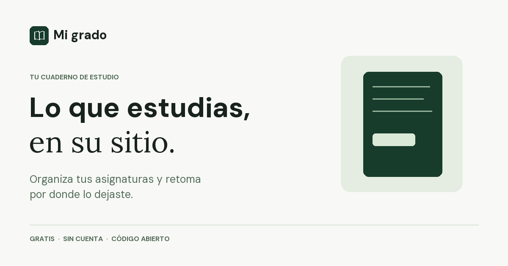
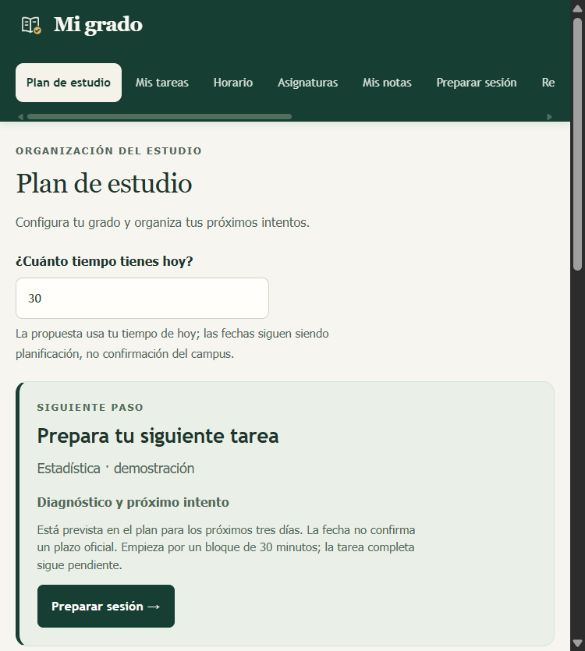

<p align="center"></p>

<p align="center">
<a href="https://github.com/Aybar17/mi-grado-app/actions/workflows/smoke.yml"></a>
<a href="LICENSE"></a>

</p>

# Mi grado

**Un cuaderno de estudio gratuito para organizar qué hacer, registrar tu intento y retomar donde lo dejaste.** Para universidad y FP; Obsidian y la IA son opcionales.

**[Abrir Mi grado en el navegador](https://aybar17.github.io/mi-grado-app/app/)** · [Conocer el proyecto](https://aybar17.github.io/mi-grado-app/) · [Descargar para Windows](https://github.com/Aybar17/mi-grado-app/releases/tag/v0.9.0-rc.3) · [Contribuir](CONTRIBUTING.md)

> **Versión en pruebas:** el código y la web están abiertos para recibir comentarios. Las pruebas independientes de uso y recuperación en otros dispositivos siguen pendientes; no se trata de una versión estable. Empieza con datos de ejemplo y descarga una copia de tu cuaderno.

## De la tarea al siguiente intento

1. **Planifica:** añade asignaturas, tareas y exámenes. Indica cuánto tiempo tienes y revisa la propuesta.
2. **Registra:** guarda qué intentaste, qué ayuda recibiste y tu siguiente paso.
3. **Retoma:** vuelve al cuaderno y recupera el punto donde te quedaste.



[Ver una demostración de 24 segundos](docs/imagenes/demo.gif) · [Guía de inicio](docs/INICIO.md)

## Tus datos y los límites actuales

La web guarda el cuaderno en el navegador de ese dispositivo; puedes descargar copias JSON y exportar Markdown. El navegador podría borrar su almacenamiento, así que **guarda copias y comprueba que puedes recuperarlas**. No hay sincronización automática entre dispositivos.

En Windows el programa usa las carpetas que elijas. La IA, cuando la usas, recibe solo el contexto que decidas compartir con su proveedor. Mi grado no lee automáticamente otros chats ni sincroniza tu campus. Registrar una tarea o una explicación no demuestra por sí solo una entrega ni dominio, y no prometemos mejores notas.

## Uso local y desarrollo

La [guía de inicio](docs/INICIO.md) explica la web, el paquete Windows y las copias. Para ejecutar el código fuente con datos ficticios necesitas Python 3.11 o posterior:

```sh
python escritorio.py --demo
```

El modo con tus apuntes se inicia con `python escritorio.py`. [Configuración, pruebas y arquitectura](docs/DESARROLLO.md).

## Participar

Los informes de errores, pruebas de primer uso, documentación y mejoras de accesibilidad son bienvenidos. Consulta las [incidencias](https://github.com/Aybar17/mi-grado-app/issues) y la [guía para contribuir](CONTRIBUTING.md). Comparte ejemplos ficticios, nunca apuntes privados, claves o conversaciones.

[Hoja de ruta](docs/HOJA_DE_RUTA.md) · [Cómo probar el piloto](docs/PILOTO.md) · [Licencia MIT](LICENSE) · [Procedencia y licencias de terceros](ATTRIBUTION.md)

---

**English:** Mi grado is an experimental, local-first study notebook for university and vocational students. Plan a next step, record your attempt and resume later. Obsidian and AI are optional. The interface is currently in Spanish. [Try the web app](https://aybar17.github.io/mi-grado-app/app/) or [contribute](CONTRIBUTING.md).
